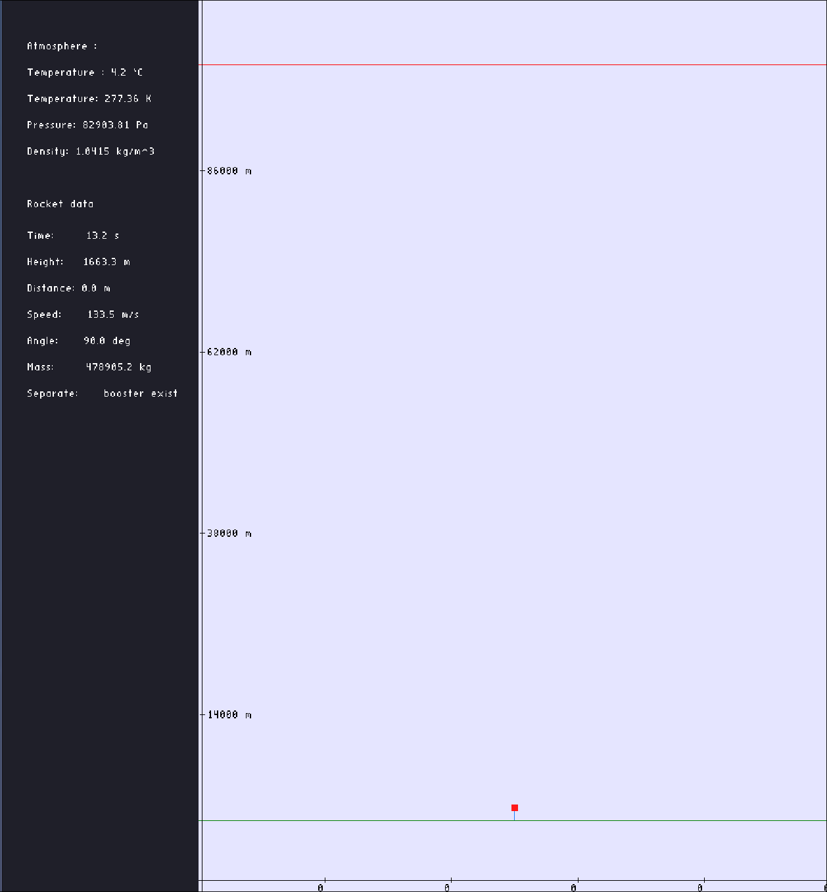
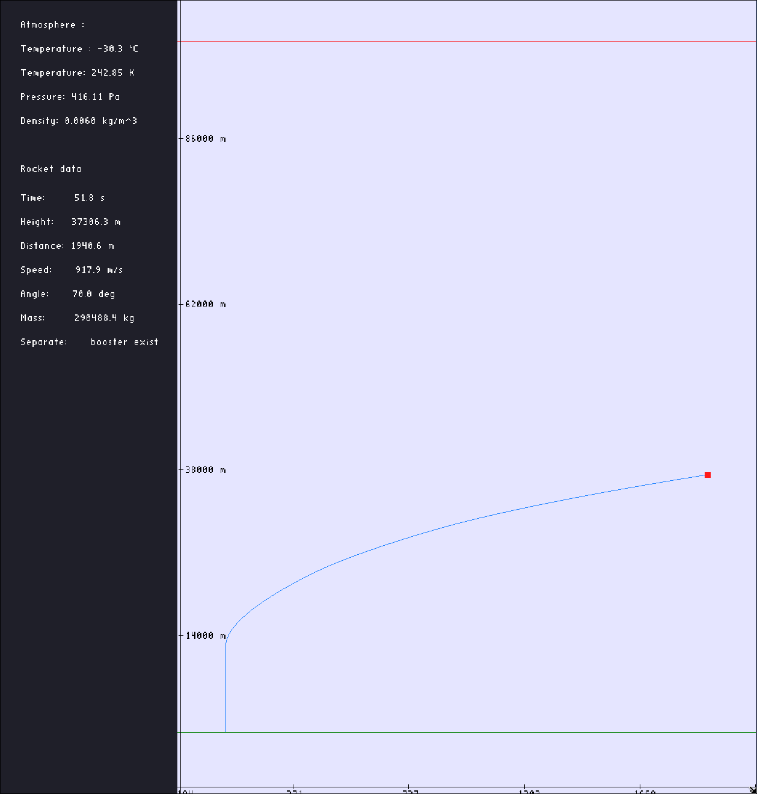
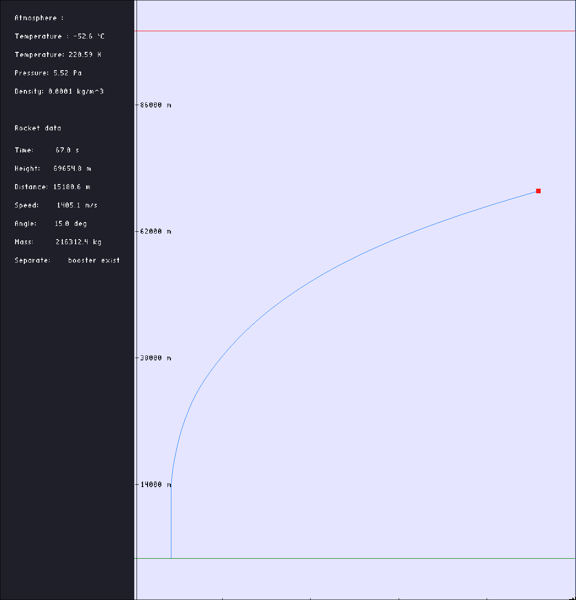
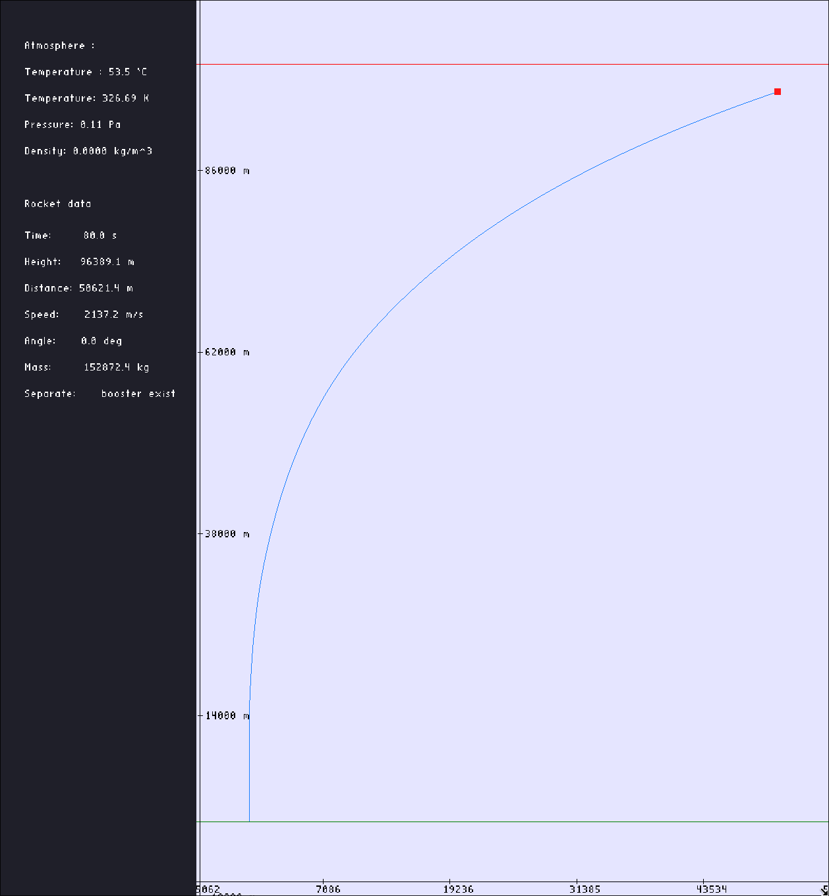
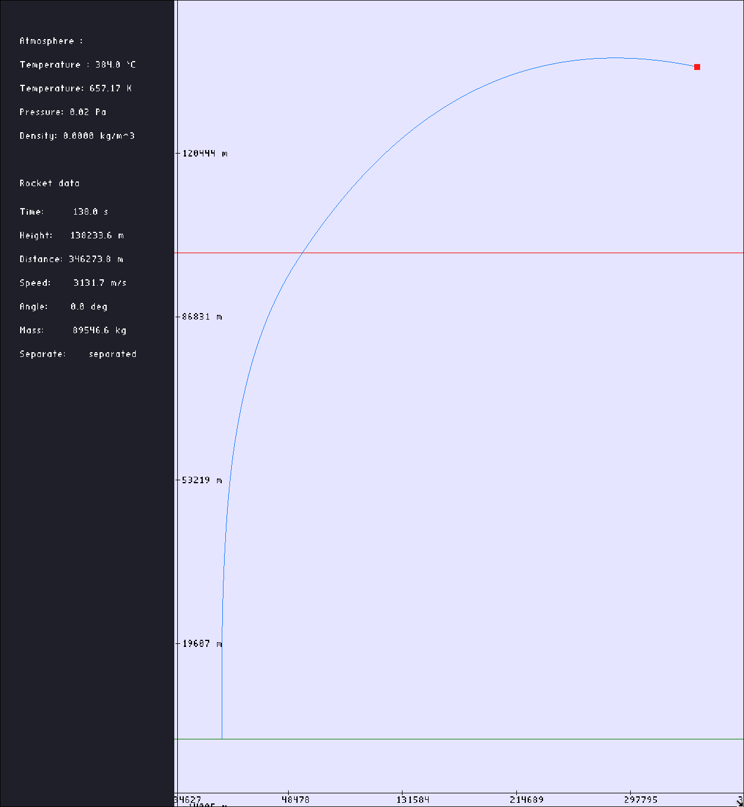
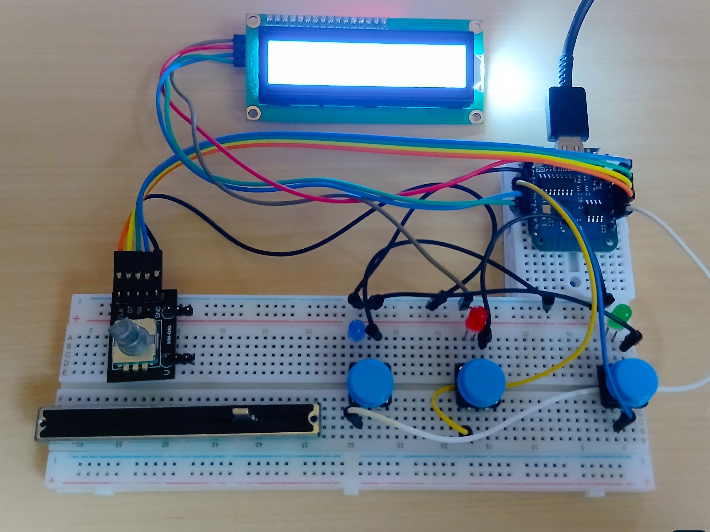

# Rocket Flight Simulator — Version 0.5

## Project Overview

This project is a rocket flight simulator written in modern C++.  
Its main goal is to create a physically accurate and extensible simulation of rocket flight, with a focus on clean architecture, correct physical units, and visualization.

The core of the project is the flight simulation itself:
- Two-stage rocket model.
- Atmospheric model.
- Aerodynamic drag.
- Engine thrust and fuel consumption.
- Automatic stage separation.
- Flight trajectory and telemetry data.

The project uses `mp-units` for type-safe physical units and calculations. This helps prevent unit errors, such as mixing meters with kilometers or radians with degrees.

For visualization, the project uses OpenGL. The long-term goal is to develop a full 3D visualization of the rocket, its trajectory, and the flight environment.

## University Project Module

As part of a university project, the simulator was extended with an external control and telemetry system.

This module includes:
- A hardware control panel connected to the simulator over Wi-Fi.
- Real-time commands for changing the flight angle, launching the rocket, and aborting the mission.
- Transmission of telemetry data to external applications.
- A graph window for visualizing flight data.

This part was implemented using Boost.Asio for network communication. It demonstrates how the simulation core can be integrated with external hardware, control interfaces, and real-time data exchange.

## Main Achievements in Version 0.5

- Implemented aerodynamic friction drag in the flight model.
- Built a hardware control panel that sends real-time commands to the simulator:
  - Change the flight angle.
  - Launch the rocket.
  - Abort the mission.
- Implemented network communication using Boost.Asio.

## Secondary Achievements

- Improved telemetry transmission to external applications over Wi-Fi.
- Improved the graph window and flight-data visualization.
- Improved synchronization between the simulation loop, network communication, and graphical output.

## Technologies

- C++
- mp-units
- OpenGL
- Boost.Asio
- TCP/IP over Wi-Fi
- Embedded hardware controller

## Development Goals

- Improve the physical accuracy of the atmospheric and aerodynamic models.
- Expand the simulation toward orbital mechanics.
- Develop a full 3D OpenGL visualization.
- Keep the simulation core independent from external interfaces and hardware.

## Screenshots

### Launching a rocket using board_panel

### Board_panel 

